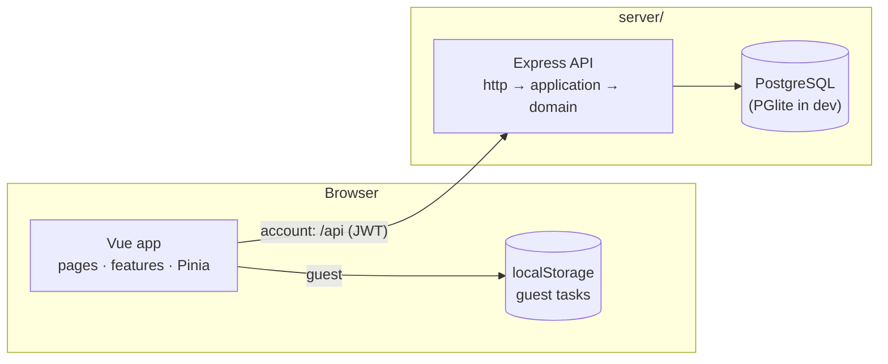
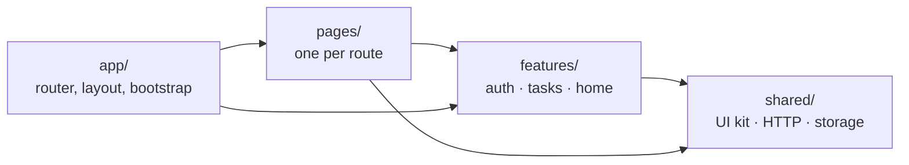
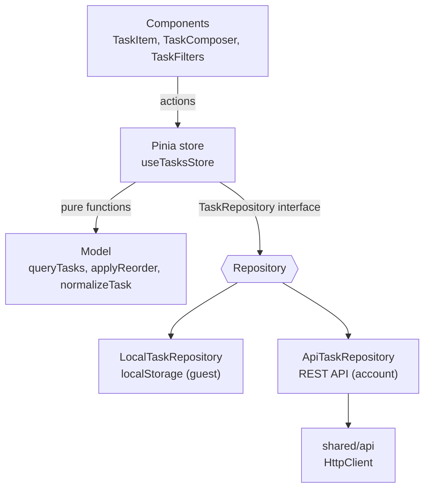

# TODOS — Task Planner


A full-stack task planner: a **Vue 3 + TypeScript + Pinia** frontend and an **Express + PostgreSQL** backend ([`server/`](server/README.md)). Use it as a guest with tasks saved in the browser, or create an account to sync tasks through the API.

## Features

- **Tasks with details**: title, description, deadline, priority (high / medium / low) and labels
- **Combinable filters**: status, title search and labels (match any or all), sorted manually, by deadline or by priority
- **Drag-and-drop ordering** that also works inside a filtered view
- **Inline editing**: double-click a task to rename it, Enter saves, Esc cancels
- **Undo** after clearing completed tasks, with deletion delayed until the undo window closes
- **Overdue and due-today badges**, task counters, a loading skeleton and empty states
- **Guest or account mode**: guests use `localStorage`. When a guest signs up or logs in, the app offers to import their tasks.
- **JWT authentication**: protected routes, redirect back after login, automatic logout on an expired session
- **Optimistic updates** that roll back with an error message if the request fails
- **Dark mode**, a responsive layout and accessible controls (labels, ARIA states, keyboard support)

## Tech stack

| Area      | Tools                                                                                     |
| --------- | ----------------------------------------------------------------------------------------- |
| Framework | Vue 3 (Composition API, `<script setup>`)                                                 |
| Language  | TypeScript (strict, checked with `vue-tsc`)                                               |
| State     | Pinia                                                                                     |
| Routing   | Vue Router: lazy-loaded pages, auth guards, page titles                                   |
| Styling   | Tailwind CSS v4 with semantic design tokens, PrimeIcons                                   |
| Testing   | Vitest, Vue Test Utils, V8 coverage                                                       |
| Quality   | ESLint (incl. layer-boundary rules), Prettier                                             |
| Backend   | Express, Drizzle ORM, PostgreSQL / PGlite, Zod, JWT, bcrypt ([details](server/README.md)) |
| CI        | GitHub Actions: frontend, backend (with real PostgreSQL) and full-stack integration jobs  |

## Architecture



The backend has its own layers, API reference and security notes in [server/README.md](server/README.md). The rest of this section covers the frontend.

The frontend code is organized by feature, with dependencies pointing in one direction:



ESLint enforces these boundaries: `shared/` can't import features, and features can't import pages or `app/`.

Inside the **tasks** feature, each layer has one job:



- **Model**: pure TypeScript with no Vue imports. Handles filtering, sorting, reordering and validation, and is the easiest layer to test.
- **Repositories**: guest storage and the backend implement the same `TaskRepository` interface. The store picks one based on auth state, so no action needs an `if (loggedIn)` branch.
- **Store**: holds the app state and runs actions with optimistic updates and rollback.
- **Components**: render state and emit events. UI-only state, like a form draft or rename mode, stays in the component that uses it.
- **HTTP client**: a typed wrapper around `fetch` with timeouts, `HttpError`/`NetworkError` and auth hooks. Auth is connected in `main.ts`, so `shared/` doesn't depend on the auth feature.

```
src/
├── app/                 # App.vue, router (+ guards), layout, global styles
├── pages/               # Route components
├── features/
│   ├── auth/            # api, store, validation, useAuthForm, auth UI
│   ├── tasks/           # model, repositories, store, task UI
│   └── home/            # landing page sections and content
└── shared/
    ├── api/             # HttpClient, error types
    ├── lib/             # storage, notifications, safe redirects
    ├── theme/           # dark mode
    └── ui/              # BaseButton, BaseInput, BaseCard, BaseBadge, ...
```

Tests sit in `__tests__/` folders next to the code they test.

## Getting started

Requires Node.js 20.19+ or 22.12+.

```sh
npm run setup      # installs the frontend and server dependencies
npm run dev:all    # web on http://localhost:5173, API on http://localhost:3000
```

No database setup is needed: the API uses an embedded PostgreSQL (PGlite) by default. To try a ready-made account with sample tasks, run `npm run db:seed --prefix server` and log in as `demo@example.com` / `demo-password-123`.

In development, the app calls `/api` on its own origin and Vite proxies it to the backend. For production builds, set `VITE_API_URL` to the API's URL (see `.env.example`). Guest mode works without the backend.

## Testing

| Level              | Where                                    | What it covers                                                                           |
| ------------------ | ---------------------------------------- | ---------------------------------------------------------------------------------------- |
| Unit and component | `src/**/__tests__`                       | Task model, stores, repositories, HTTP client, components                                |
| Backend            | `server/src/**/*.test.ts`, `server/test` | Domain rules, services, HTTP API, repositories on PGlite and real PostgreSQL, migrations |
| Full-stack         | `integration/`                           | The frontend's own API code against the real backend and database                        |

## Scripts

| Command                    | Description                                      |
| -------------------------- | ------------------------------------------------ |
| `npm run dev:all`          | Start the web app and the API                    |
| `npm run dev`              | Start only the web app                           |
| `npm run setup`            | Install frontend and server packages             |
| `npm run build`            | Type-check and build for production              |
| `npm run preview`          | Preview the production build                     |
| `npm test`                 | Run unit and component tests                     |
| `npm run test:coverage`    | Run tests with a coverage report                 |
| `npm run test:integration` | Run full-stack tests (needs `server/` installed) |
| `npm run typecheck`        | Type-check with `vue-tsc`                        |
| `npm run lint`             | Lint and auto-fix with ESLint                    |
| `npm run format`           | Format with Prettier                             |
