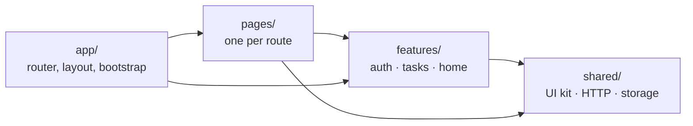
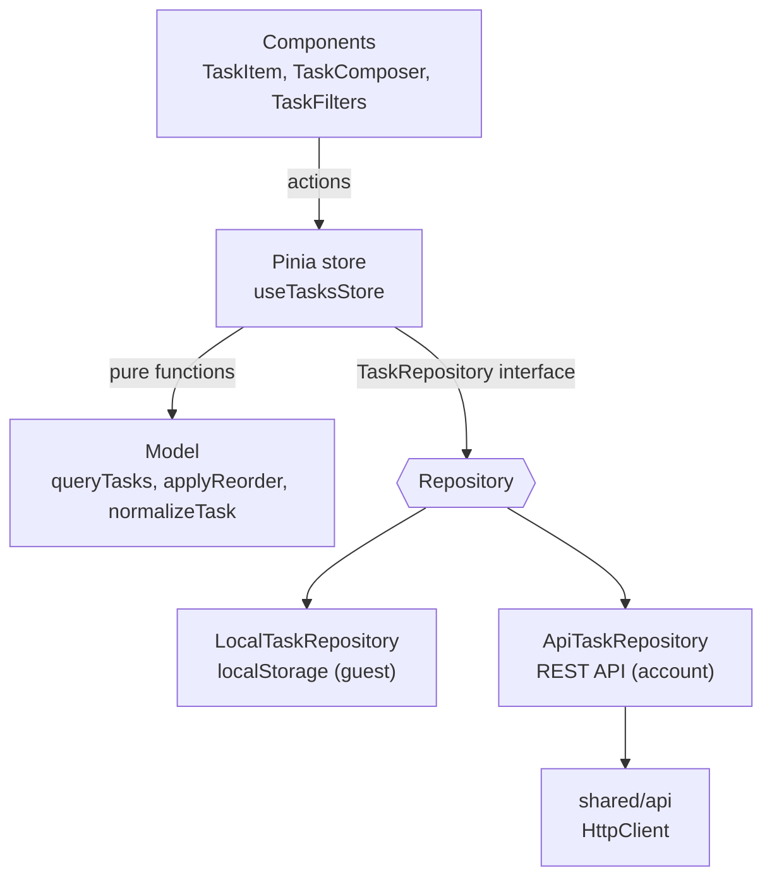

# TODOS — Task Planner


A task-planning web app built with **Vue 3**, **TypeScript**, **Pinia** and **Tailwind CSS**. Use it as a guest with tasks saved in the browser, or create an account to store tasks on the server through a REST API.

## Features

- **Tasks with details**: title, description, deadline, priority (high / medium / low) and labels
- **Combinable filters**: status, title search and labels (match any or all), sorted manually, by deadline or by priority
- **Drag-and-drop ordering** that also works inside a filtered view
- **Inline editing**: double-click a task to rename it, Enter saves, Esc cancels
- **Undo** after clearing completed tasks, with deletion delayed until the undo window closes
- **Overdue and due-today badges**, task counters, a loading skeleton and empty states
- **Guest or account mode**: guests use `localStorage`. When a guest signs up or logs in, the app offers to import their tasks.
- **JWT authentication**: protected routes, redirect back after login, automatic logout on an expired session
- **Optimistic updates** that roll back with an error message if the request fails
- **Dark mode**, a responsive layout and accessible controls (labels, ARIA states, keyboard support)

## Tech stack

| Area      | Tools                                                    |
| --------- | -------------------------------------------------------- |
| Framework | Vue 3 (Composition API, `<script setup>`)                |
| Language  | TypeScript (strict, checked with `vue-tsc`)              |
| State     | Pinia                                                    |
| Routing   | Vue Router: lazy-loaded pages, auth guards, page titles  |
| Styling   | Tailwind CSS v4 with semantic design tokens, PrimeIcons  |
| Testing   | Vitest, Vue Test Utils, V8 coverage                      |
| Quality   | ESLint (incl. layer-boundary rules), Prettier            |
| CI        | GitHub Actions: lint, format, type check, test and build |

## Architecture

The code is organized by feature, with dependencies pointing in one direction:



ESLint enforces these boundaries: `shared/` can't import features, and features can't import pages or `app/`.

Inside the **tasks** feature, each layer has one job:



- **Model**: pure TypeScript with no Vue imports. Handles filtering, sorting, reordering and validation, and is the easiest layer to test.
- **Repositories**: guest storage and the backend implement the same `TaskRepository` interface. The store picks one based on auth state, so no action needs an `if (loggedIn)` branch.
- **Store**: holds the app state and runs actions with optimistic updates and rollback.
- **Components**: render state and emit events. UI-only state, like a form draft or rename mode, stays in the component that uses it.
- **HTTP client**: a typed wrapper around `fetch` with timeouts, `HttpError`/`NetworkError` and auth hooks. Auth is connected in `main.ts`, so `shared/` doesn't depend on the auth feature.

```
src/
├── app/                 # App.vue, router (+ guards), layout, global styles
├── pages/               # Route components
├── features/
│   ├── auth/            # api, store, validation, useAuthForm, auth UI
│   ├── tasks/           # model, repositories, store, task UI
│   └── home/            # landing page sections and content
└── shared/
    ├── api/             # HttpClient, error types
    ├── lib/             # storage, notifications, safe redirects
    ├── theme/           # dark mode
    └── ui/              # BaseButton, BaseInput, BaseCard, BaseBadge, ...
```

Tests sit in `__tests__/` folders next to the code they test.

## Getting started

Requires Node.js 20.19+ or 22.12+.

```sh
npm install
cp .env.example .env   # set VITE_API_URL to your backend URL
npm run dev
```

Guest mode works without a backend. Account features need the TODOS API running at `VITE_API_URL` (default `http://localhost:3000`), with these endpoints:

| Method | Endpoint             | Description           |
| ------ | -------------------- | --------------------- |
| POST   | `/api/auth/register` | Create account → JWT  |
| POST   | `/api/auth/login`    | Log in → JWT          |
| GET    | `/api/tasks`         | List the user's tasks |
| POST   | `/api/tasks`         | Create a task         |
| PUT    | `/api/tasks/:id`     | Update a task         |
| DELETE | `/api/tasks/:id`     | Delete a task         |

## Scripts

| Command                 | Description                          |
| ----------------------- | ------------------------------------ |
| `npm run dev`           | Start the dev server                 |
| `npm run build`         | Type-check and build for production  |
| `npm run preview`       | Preview the production build         |
| `npm test`              | Run unit and component tests         |
| `npm run test:coverage` | Run tests with a coverage report     |
| `npm run typecheck`     | Type-check with `vue-tsc`            |
| `npm run lint`          | Lint and auto-fix with ESLint        |
| `npm run format`        | Format with Prettier                 |
